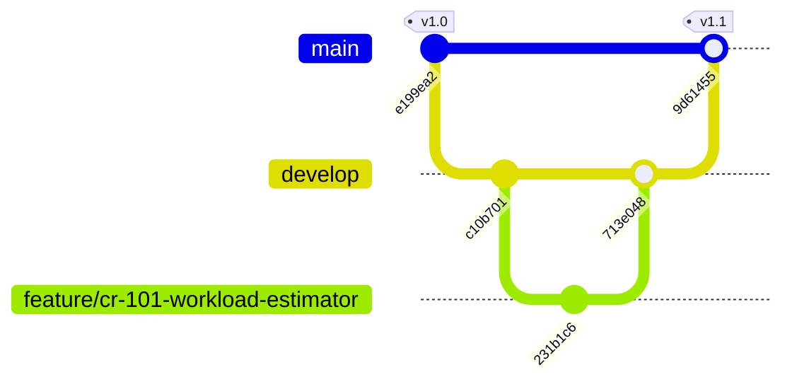

# Task 2: Software Configuration Management (SCM) & Change Control Flow
**Course:** Software Engineering (Lab Integrated) - 231CS523  
**Project:** EduTask - Student Task Management System  
**Baseline Progression:** Baseline v1.0 $\rightarrow$ Change Request CR-101 $\rightarrow$ Baseline v1.1  

---

## 1. Branching Strategy: GitFlow Architecture

EduTask adheres to the industry-standard **GitFlow** branching model to enforce strict separation between production releases, ongoing integrations, and isolated feature enhancements.



### Branch Hierarchy:
1. **`main` (Production Branch):**
   - Stores exclusively released, stable, and production-tested code.
   - Protected against direct commits.
   - Releases are demarcated with annotated cryptographic Git tags: `v1.0` and `v1.1`.
2. **`develop` (Integration Branch):**
   - Serves as the day-to-day continuous integration branch where completed features are merged and tested.
3. **`feature/cr-101-workload-estimator` (Feature / Change Request Branch):**
   - Spawned off `develop` specifically to implement approved Change Request **CR-101**.
   - Isolated from other team members' code until code review and regression testing pass.

---

## 2. Baseline Management & Version Tagging

A **Software Baseline** is a formally reviewed and agreed-upon specification or intermediate product that serves as the basis for further development, and can only be changed through formal change control procedures.

### Baseline Tags in Repository:

```bash
$ git tag -l -n
v1.0            Baseline v1.0: Core Task CRUD, Course Tagging, and REST API
v1.1            Baseline v1.1: Production release with CR-101 Workload Analytics and Priority Filters
```

- **Baseline v1.0 (Commit `e199ea2`):** Established after Sprint 1. Contains fundamental Task schema, in-memory repository, FastAPI CRUD endpoints, and initial static HTML interface.
- **Baseline v1.1 (Commit `9d61455`):** Established after CCB approval of CR-101. Incorporates automated study load analytics, priority filters, overdue detector, and PyTest test suite with 100% pass rate.

---

## 3. Formal Change Control: Change Request CR-101

### Change Request Form (CR-101)

| Field | Detail |
| :--- | :--- |
| **Change Request ID** | **CR-101** |
| **Date of Submission** | 2026-11-13 |
| **Requester** | Student Academic Senate / Course Instructor (231CS523) |
| **Title** | Implement Study Workload Hours Estimator, Overdue Alerting & Priority Filtering |
| **Module Affected** | `src/models.py`, `src/task_service.py`, `src/main.py`, `src/static/` |
| **Priority** | High |
| **Target Baseline** | Baseline v1.1 |

### Problem Statement & Business Justification:
In Baseline v1.0, students can only create and complete tasks with flat priority flags. Students reported inability to estimate remaining study workload hours across multiple registered courses (e.g. 231CS523 vs 231CS521) and suffered missed deadlines due to lack of automated overdue warning flags.

### Proposed Technical Changes:
1. Extend `Task` schema with `estimated_hours: float` (min 0.5h, max 50h) and dynamic `is_overdue: bool`.
2. Introduce `/api/tasks/analytics/workload` endpoint computing total hours, remaining hours, and overall completion percentage.
3. Add client-side responsive analytics metrics banner and real-time search/priority filtering toolbar.
4. Expand automated test suite in `tests/test_tasks.py` to prevent regression.

---

## 4. Change Control Board (CCB) Review & Approval

The **Change Control Board (CCB)** convened on Day 14 of the project schedule.

### CCB Decision Matrix:

| CCB Member | Role | Vote | Remarks |
| :--- | :--- | :---: | :--- |
| **Member 1** | Project Lead / DevOps | **APPROVED** | Minimal infrastructure footprint; no breaking database migrations needed. |
| **Member 2** | Backend Developer | **APPROVED** | Estimated 4 hours implementation in `task_service.py`. REST contract backwards compatible. |
| **Member 3** | Frontend Developer | **APPROVED** | Dynamic DOM cards can seamlessly display remaining hours and badges. |
| **Member 4** | QA / SCM Lead | **APPROVED** | Requires 4 new unit test cases covering edge cases (zero tasks, 100% completion). |

**CCB Final Verdict:** **APPROVED UNANIMOUSLY**. Feature branch authorized: `feature/cr-101-workload-estimator`.

---

## 5. End-to-End Git Execution Flow (Screenshot Capture Commands)

Below are the exact commands and live terminal outputs from the repository reflecting the complete lifecycle:

### Step 1: Branch Creation and Work Isolation
```bash
git checkout develop
git checkout -b feature/cr-101-workload-estimator
# Implement code changes in src/ and tests/
git add src/ models.py task_service.py main.py tests/
git commit -m "feat(cr-101): implement study hour workload analytics and priority filtering (CR-101)"
```

### Step 2: Regression Testing Prior to Merge
```bash
python -m pytest tests/ -v
# Output: 18 passed in 0.48s
```

### Step 3: Pull Request Merge to Develop
```bash
git checkout develop
git merge --no-ff feature/cr-101-workload-estimator \
  -m "Merge pull request #1 from feature/cr-101-workload-estimator into develop (CR-101 Approved by CCB)"
```

### Step 4: Production Release Merge & Tagging New Baseline v1.1
```bash
git checkout main
git merge --no-ff develop \
  -m "Release v1.1.0: Student Task Management System with CR-101 Analytics"
git tag -a v1.1 -m "Baseline v1.1: Production release with CR-101 Workload Analytics and Priority Filters"
```

### Step 5: Live Git Commit Graph Output (`git log --graph`)
```
*   9d61455 (HEAD -> main, tag: v1.1) Release v1.1.0: Student Task Management System with CR-101 Analytics
|\  
| *   713e048 (develop) Merge pull request #1 from feature/cr-101-workload-estimator into develop (CR-101 Approved by CCB)
| |\  
| | * 231b1c6 (feature/cr-101-workload-estimator) feat(cr-101): implement study hour workload analytics and priority filtering (CR-101)
| |/  
| * c10b701 ci: configure GitHub Actions workflow, Dockerfile, IaC, and monitoring
|/  
* e199ea2 (tag: v1.0) feat: initial release of Student Task Management System (Baseline v1.0)
```
